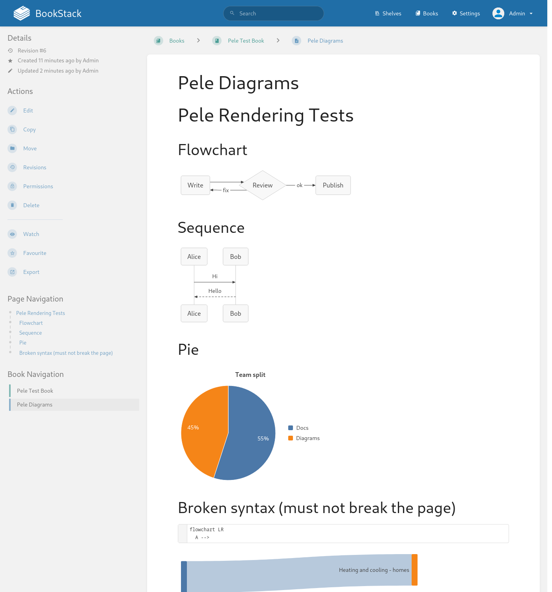
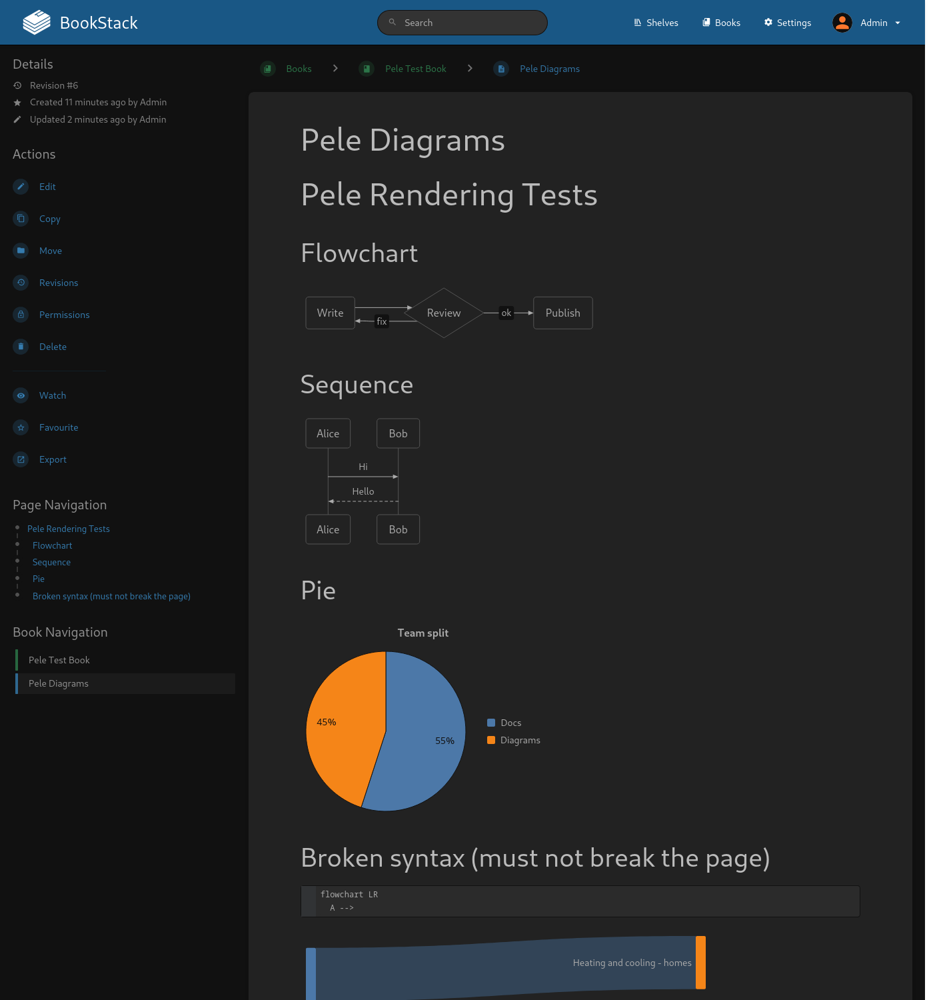
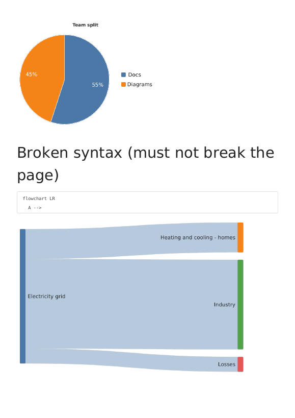
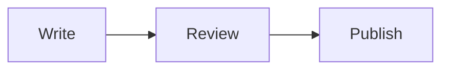

# Pele Diagrams for BookStack

Renders ```` ```mermaid ```` code blocks as diagrams in
[BookStack](https://www.bookstackapp.com/) — server-side, via the
[Pele](https://pele.run/) renderer — with full-fidelity **PDF** and
**HTML/ZIP exports**.

| Light | Dark |
|---|---|
|  |  |

Diagrams in an exported PDF:



## Why this instead of a client-side Mermaid hack?

Client-side renderers (including BookStack's official Mermaid Viewer hack) replace
code blocks *in the browser*, which means BookStack's server-side PDF exporter
only ever sees the raw code block. This module renders on the server instead:

- **PDF exports** embed high-DPI PNG diagrams (dompdf-safe).
- **HTML/ZIP exports** contain self-contained inline SVG.
- **Page views** get CSS-variable-driven SVG that follows BookStack's
  light/dark theme and instance accent colour automatically.
- **No client JavaScript**, no third-party CDN: the only runtime dependency is
  a small local renderer service.

Stored page HTML is never modified — search text, revisions and the
WYSIWYG/Markdown editors stay clean. Broken diagram syntax degrades gracefully
to a normal code block.

## Requirements

- BookStack **v26.03 or newer** (theme module system; tested on v26.09.1)
- Docker (for the `pele-render` sidecar service)
- An active BookStack theme folder / `APP_THEME` (any theme works)

## Installation

### 1. Run the sidecar service

Add the renderer service to your `docker-compose.yml` (a prebuilt image is
published to GitHub Container Registry for `linux/amd64` and `linux/arm64`):

```yaml
  pele-render:
    image: ghcr.io/felixyman/bookstack-pele-render:1.1.0
    container_name: bookstack_pele_render
    environment:
      - PELE_RENDER_TOKEN=${PELE_RENDER_TOKEN:?set PELE_RENDER_TOKEN in .env}
      - HOME=/tmp
      - XDG_CACHE_HOME=/tmp
    restart: unless-stopped
    read_only: true
    tmpfs:
      - /tmp
    cap_drop:
      - ALL
    security_opt:
      - no-new-privileges:true
    mem_limit: 256m
    cpus: 1.0
```

You can also build the image from source instead — replace `image:` with
`build: ./pele-render` and copy this repository's `pele-render/` folder next to
your compose file (see Development below). The `latest` tag tracks the newest
release.

Generate a shared token and put it in a `.env` file next to your compose file:

```bash
openssl rand -hex 24     # → PELE_RENDER_TOKEN=<output>
```

The sidecar manages its own copy of Pele and its diagram types, so it needs no
internet access at runtime. It deliberately publishes **no ports**; it is only
reachable by other services on the same Docker network.

### 2. Install the theme module

Create the theme folder and enable it (skip if you already use a theme):

```bash
mkdir -p themes/pele        # inside your BookStack installation folder
echo 'APP_THEME=pele'       # add to your BookStack .env
```

Install the module ZIP:

```bash
php artisan bookstack:install-module pele-diagrams-1.1.0.zip
```

The module ZIPs are attached to
[GitHub releases](https://github.com/felixyman/bookstack-pele/releases) and the
installer accepts either a URL or a local path:

```bash
php artisan bookstack:install-module \
  https://github.com/felixyman/bookstack-pele/releases/download/v1.1.0/pele-diagrams-1.1.0.zip
```

Installing from a URL shows two confirmation prompts: one to trust the
download source (GitHub release assets redirect to
`release-assets.githubusercontent.com`) and one to confirm the module
installation. If BookStack reports that no active theme folder exists, you can
let it create one — it will make `themes/custom`, in which case set
`APP_THEME=custom` instead. On a Dockerized BookStack this is often easier to
run inside the container:

```bash
docker exec -it bookstack php artisan bookstack:install-module /path/inside/container.zip
```

<details>
<summary>Manual installation (no module command)</summary>

Copy the `pele-diagrams/` folder to `themes/<your-theme>/modules/pele-diagrams`
and ensure `APP_THEME` is set.
</details>

### 3. Point the module at the sidecar

On the **BookStack** container / environment, add:

```yaml
      - PELE_RENDER_URL=http://pele-render:3000
      - PELE_RENDER_TOKEN=${PELE_RENDER_TOKEN}
```

Recreate the containers, then write a `mermaid` code block on any page.

> Using BookStack outside Docker? Run the sidecar anywhere reachable from your
> BookStack host and set `PELE_RENDER_URL` accordingly (e.g.
> `http://127.0.0.1:3000` with a published port on the sidecar).

## Usage

In the Markdown editor:

````markdown

````

In the WYSIWYG editor: create a code block and set its language to `mermaid`.

Diagrams are rendered when the page is displayed. Broken syntax stays visible
as a code block, and the rest of the page is unaffected.

## Configuration

Set on the BookStack environment:

| Variable | Default | Meaning |
|---|---|---|
| `APP_THEME` | — | Must point at the theme that hosts the module |
| `PELE_RENDER_URL` | `http://pele-render:3000` | Sidecar base URL |
| `PELE_RENDER_TOKEN` | — | Shared secret; must match the sidecar |
| `PELE_MAX_WIDTH` | `900` | Layout width passed to Pele when rendering |

Set on the sidecar:

| Variable | Default | Meaning |
|---|---|---|
| `PELE_RENDER_TOKEN` | — | Shared secret (required) |
| `PELE_PNG_SCALE` | `2` | Raster scale for PDF export images |
| `PELE_MAX_BATCH` | `50` | Max diagrams per request |
| `PELE_MAX_SOURCE` | `50000` | Max diagram source length |
| `PELE_FONT_FAMILY` / `PELE_FONT_FAMILY_MONO` | `DejaVu Sans` / `DejaVu Sans Mono` | Fonts used for measurement and rasterising |

## How it works

```
page view / export
  └─ theme view overrides (rendered after BookStack's content filtering)
       └─ PeleTheme.php  ── cache lookup (30 days per source + mode)
            └─ POST /render ──► pele-render sidecar (Pele + resvg)
                 ├─ web    → CSS-variable SVG    (themed by pele-bookstack.css)
                 ├─ export → literal-colour SVG  (self-contained HTML/ZIP exports)
                 └─ pdf    → high-DPI PNG        (dompdf-safe)
```

The module transforms page content inside the view layer
(`pages.parts.page-display` and `exports.parts.page-item`). This is
deliberate: an earlier approach using the `PAGE_CONTENT_POST_RENDER` theme
event failed for exports because BookStack renders export HTML twice and the
second pass re-filters the content, stripping injected SVG and `data:` images.
Transforming at view-render time runs after all content filtering and reaches
web pages, HTML exports and the PDF engine intact.

Rendering failures are never cached, so a temporarily unavailable sidecar (or a
diagram you just fixed) recovers automatically on the next page view.

## Theming

Web views map Pele's CSS variables to BookStack's palette in
`pele-diagrams/public/pele-bookstack.css`:

- Light/dark values follow BookStack's mode (`html.dark-mode`).
- `--pele-accent` follows your instance's App Color setting.
- Fonts come from BookStack's `--font-body` / `--font-code`.
- Chart series colours (`--pele-series-1..8`) use Pele's defaults and can be
  overridden in the same stylesheet.
- Diagrams can still set fixed colours via Mermaid `style` / `classDef` /
  `linkStyle` directives.

Exports intentionally always use the light palette for consistent print output.

## Limitations

- **The sidecar is required.** There is no client-side fallback mode; without a
  reachable sidecar, `mermaid` blocks simply render as code blocks.
- **View overrides can outlive their upstream partials.** If a future BookStack
  release changes `pages/parts/page-display.blade.php` or
  `exports/parts/page-item.blade.php`, re-sync the copies in
  `pele-diagrams/views/` (see the upstream files they were based on, BookStack
  v26.09.1).
- **Export colours are fixed to the light palette** (documented above).
- **No interactive zoom/pan** — diagrams are static output.
- Rendering is Pele-based; see
  [Pele's compatibility notes](https://pele.run/compatibility) for Mermaid
  syntax coverage.

## Upgrading

1. Remove the existing module folder:
   `themes/<theme>/modules/pele-diagrams`
   (the module installer has no in-place update mechanism; installing a new
   ZIP alongside an existing folder creates a suffixed duplicate).
2. Install the new ZIP the same way as above.
3. If you maintain a bind-mounted checkout instead, replace the files and
   restart the container.

Bump the module version in `bookstack-module.json` and `PeleTheme.php`
together when publishing changes (the build script enforces this).

## Uninstalling

- Delete `themes/<theme>/modules/pele-diagrams` (and remove `APP_THEME` if you
  created the theme only for this module).
- Remove the `pele-render` service and the `PELE_*` environment variables.
- Optionally clear caches: `php artisan cache:clear`.

## Development

```
pele-diagrams/      BookStack theme module (module ZIP source)
pele-render/        Node sidecar: Pele + resvg, tested with `npm test`
scripts/            build-module-zip.sh → dist/pele-diagrams-<version>.zip
docs/               screenshots
```

- Live-reload development: bind-mount `./pele-diagrams` to
  `themes/<theme>/modules/pele-diagrams`.
- Sidecar tests: `cd pele-render && npm install && npm test`
- Build the distributable module: `scripts/build-module-zip.sh`
- Releases: pushing a `v*` tag builds the module ZIP, publishes the
  `linux/amd64`/`linux/arm64` sidecar image to GHCR and creates the GitHub
  release (`.github/workflows/release.yml`). The tag must match the module
  version.

## Troubleshooting

| Symptom | Check |
|---|---|
| Diagrams show as code blocks | `docker logs bookstack_pele_render`; search BookStack's log for "Pele render service unreachable" |
| Sidecar responds 401 | `PELE_RENDER_TOKEN` must be identical on both services |
| Theme not applied | `docker exec bookstack printenv APP_THEME`; ensure the theme folder exists with the module inside |
| Multiple module versions active | The installer adds no updates in place; delete old folders under `themes/<theme>/modules/` |
| Old styling after upgrade | Bump `PeleTheme::VERSION` (invalidates the cache and asset URL) or `php artisan cache:clear` |

## License

MIT — see [LICENSE](LICENSE). Third-party components are listed in
[NOTICE.md](NOTICE.md).
